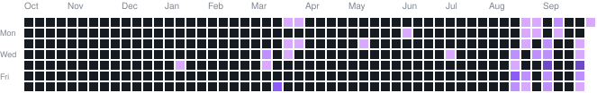

Hi, I'm **Sathyajith (Velmet)** — a student developer from **India** working **remote-only**. I like making **useful open-source apps and websites** people actually use, and on the side I'm into **AI agents + LLMs**, **robotics builds**, and **game dev with Godot**.

> Building useful software — from the web to the workbench.

| Software | AI | Hardware + Play |
|---|---|---|
| Useful open-source apps | LLM-powered tools | Small robotics builds |
| Modern websites and web apps | Agents and workflows | ESP32, sensors, motors |
| Clean, practical UI | Prototyping over hype | Godot game experiments |

**Open to:** remote opportunities and online collaboration — internships, junior / freelance work, open-source collabs.

**Core strengths**

HTML • CSS • JavaScript • TypeScript • Python • React

**Growing**

Rust — intermediate, actively developing • C# — learning • no public projects yet

**Also / tools**

Godot • Arduino • Raspberry Pi • Git • VS Code

 

Stats, languages, streak and contribution calendar update automatically from public GitHub activity.

Software is my main focus, but I also build physical things. Keeping this short — pins and repos have the code.

<b>Hardware I have built (click to expand)</b>

- **[Ushield](https://github.com/Velmet44/Ushield)** — USB security dongle: physical power / data / off switching, ESD protection, current sensing. Full schematic, PCB and BOM in the repo.
- ESP32 gaming console with TFT display
- Bluetooth cars
- Fast line follower
- Battlebot
- And more small robotics experiments

<b>Actively open to remote opportunities and collaboration — email or Discord is the fastest way to reach me.</b>

 

Discord: <b>@velmet44</b> — DMs open • <a href="https://discord.com/users/1081881317286891530">direct profile link</a>

|  |  |
|---|---|
| Email | velmet44@gmail.com |
| Discord | @velmet44 (DMs open) |
| Location | India — remote only, no onsite |

Thanks for stopping by — if you are building something interesting, let's talk.

